# Теми дизайн-системи — порівняння

Згенеровано `python tools/design_review.py`. Перший екран на телефоні (375 px) і на широкому екрані (1440 px); повні сторінки — у `full/` (не в git) і в report.html.

| Тема | 60 / 30 / 10 | Шрифти | Lighthouse (моб.): продуктивність · доступність · SEO | 375 px | 1440 px |
|---|---|---|---|---|---|
| **Смерека** (`pine`) | `#1d3127` `#efe5d3` `#d08a56` | Cormorant Garamond + Manrope | 89 · 100 · 100 | 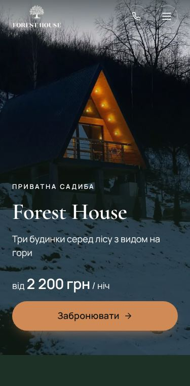 | 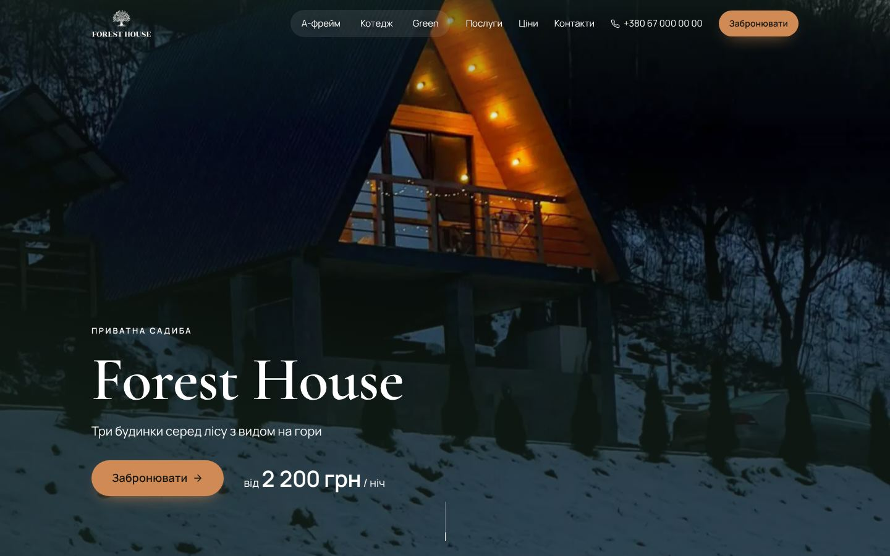 |
| **Графіт** (`graphite`) | `#1f2226` `#f3eee5` `#d4ab55` | Playfair Display + Inter | 88 · 100 · 100 | 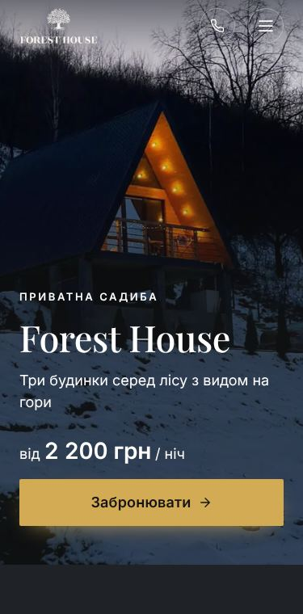 | 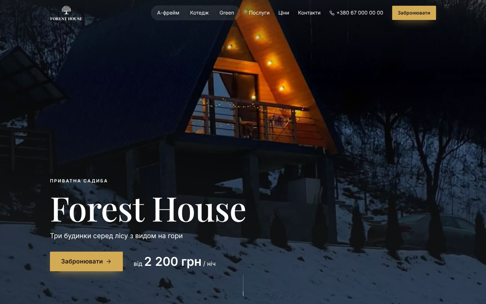 |
| **Теракота** (`terracotta`) | `#fbf9f5` `#e9e3d9` `#a9482a` | Lora + Golos Text | 90 · 100 · 100 | 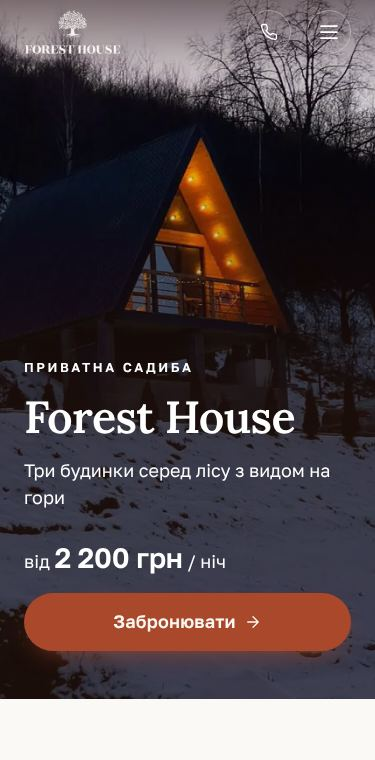 | 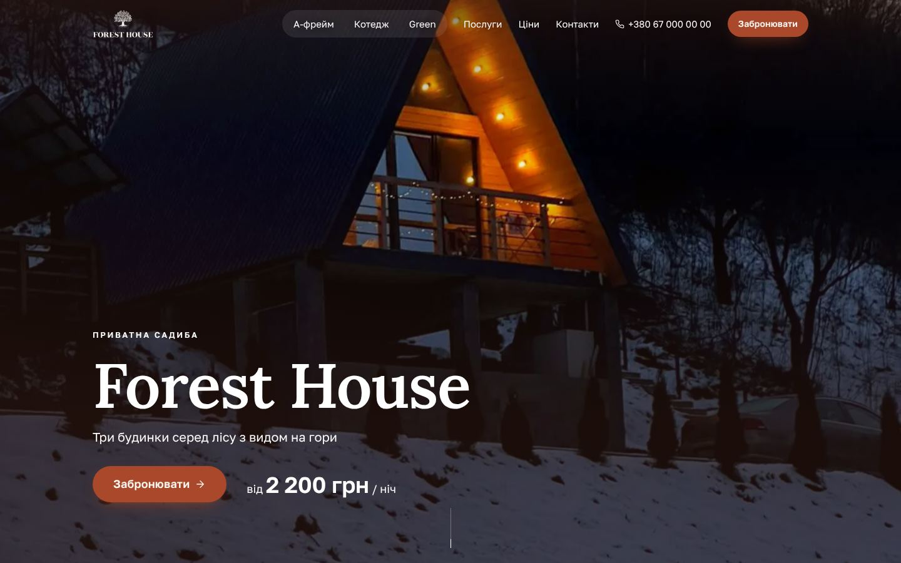 |
| **Ніч** (`night`) | `#0f141b` `#e6d8bf` `#c6e15b` | Unbounded + Onest | 90 · 100 · 100 | 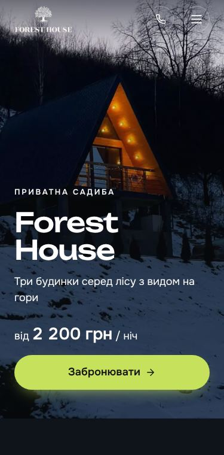 | 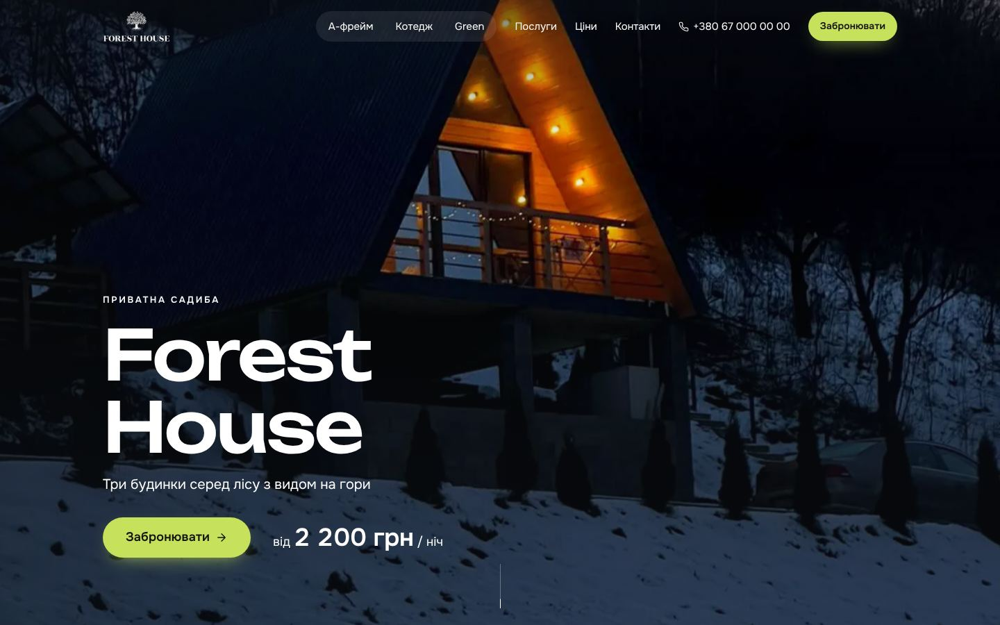 |
| **Льон** (`linen`) | `#f5f0e7` `#2e3c36` `#965c18` | Prata + Montserrat | 89 · 100 · 100 | 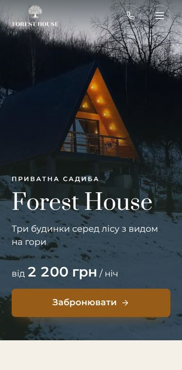 | 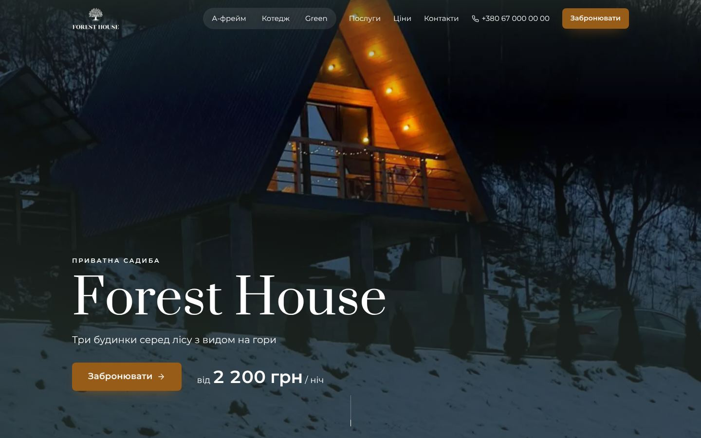 |
| **Озеро** (`lake`) | `#eef2f0` `#1f3b47` `#b04830` | Literata + Manrope | 90 · 100 · 100 | 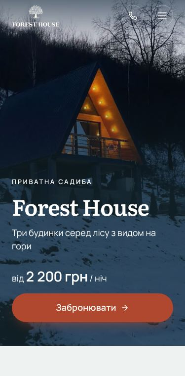 | 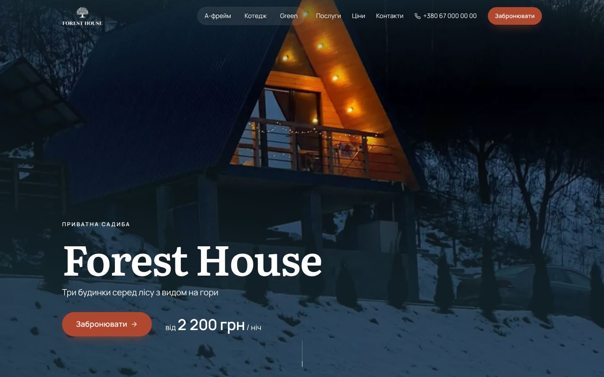 |
| **Береза** (`birch`) | `#fafaf7` `#dfe4dc` `#2c5e4b` | Forum + Commissioner | 89 · 100 · 100 | 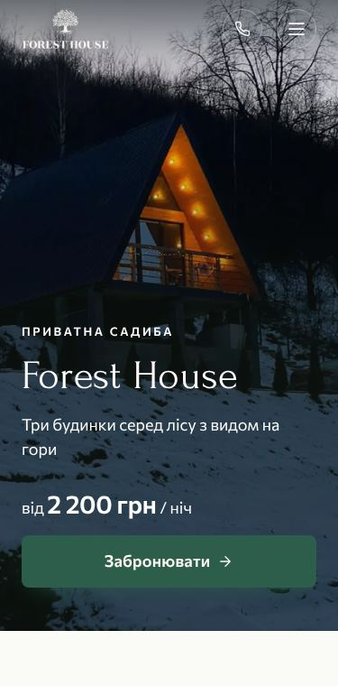 | 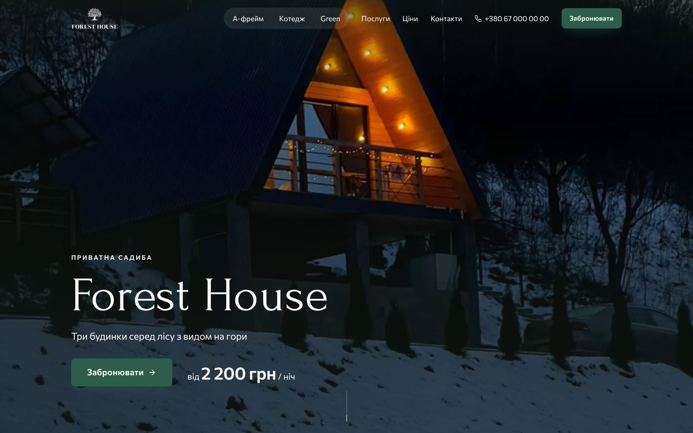 |
| **Жар** (`ember`) | `#171310` `#2a221d` `#e8783f` | Yeseva One + PT Sans | 87 · 100 · 100 | 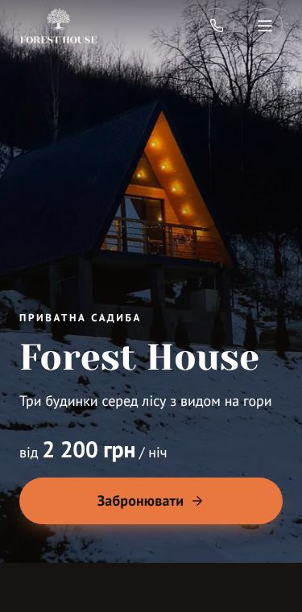 | 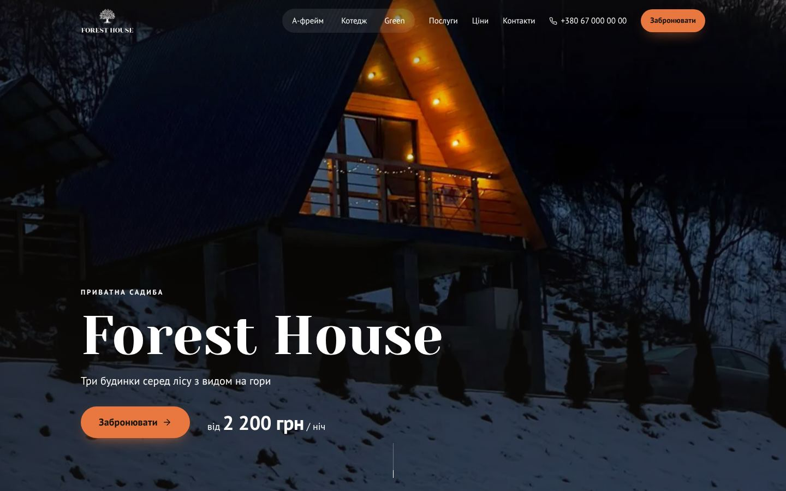 |
